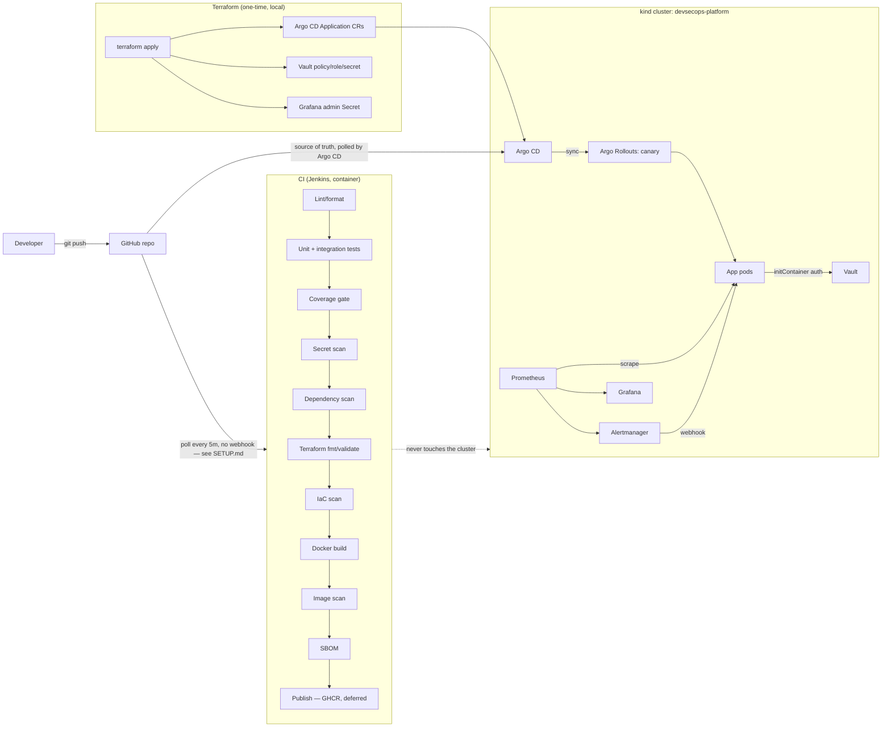

# Architecture

## System overview



**Why each box exists** (no tool added to pad a list — see `docs/SECURITY.md` §2 and `docs/IMPLEMENTATION_PLAN.md` for the per-phase reasoning behind each choice):

| Component | Responsibility | Never does |
|---|---|---|
| Jenkins | CI: lint, test, scan, build, scan image, (optionally) publish | Touch the Kubernetes cluster |
| Argo CD | Reconcile the cluster to match Git | Run arbitrary CI steps |
| Argo Rollouts | Progressive delivery (canary) for the one workload that needs it | Replace Argo CD's reconciliation |
| Terraform | One-time bootstrap: Argo CD `Application` CRs, Vault's internal config, the Grafana secret | Manage the kind cluster itself, or anything Argo CD already reconciles |
| Prometheus/Alertmanager/Grafana | Metrics, alerting, dashboards | Replace centralized logging (none exists here — see `docs/SECURITY.md` §8) |
| Vault | Demonstrate real secret injection via Kubernetes auth | Run in anything but dev mode here (see the warning in `vault/deployment.yaml`) |

## Sequence: a developer pushes code

```mermaid
sequenceDiagram
    actor Dev as Developer
    participant GH as GitHub
    participant CI as Jenkins
    participant Reg as Local image store
    participant Git as Git (deploy config)
    participant CD as Argo CD
    participant K8s as kind cluster

    Dev->>GH: git push
    Note over CI,GH: Jenkins polls every 5 min — no webhook,<br/>since Jenkins runs on localhost (see SETUP.md)
    CI->>GH: poll detects new commit
    CI->>CI: lint, unit+integration tests, coverage gate
    CI->>CI: gitleaks, trivy (deps), checkov, terraform validate
    CI->>CI: docker build
    CI->>CI: trivy (image), SBOM
    CI->>Reg: tag image (commit SHA)
    Note over CI,Git: Publish stage exists but GHCR push isn't<br/>exercised yet (no write:packages token — see IMPLEMENTATION_PLAN.md §4a).<br/>CI never writes to Git or touches the cluster.
    Dev->>Git: (separately) edits helm/devsecops-app values, pushes
    CD->>Git: polls / webhook-free refresh
    CD->>K8s: apply Rollout, Services, ConfigMap, etc.
    K8s->>K8s: Argo Rollouts runs the canary steps (setWeight, analysis, promote)
    K8s-->>CD: health/sync status
    Note over Dev,K8s: Two independent loops: CI validates and builds;<br/>Argo CD is the only thing that ever changes the cluster.
```

## Why these choices (brief tool-by-tool, full version in `docs/SECURITY.md`/`IMPLEMENTATION_PLAN.md`)

- **kind over Minikube**: faster startup, lower per-node memory on this machine, and every node is just a container, consistent with everything else in this Docker-based stack.
- **Helm over Kustomize**: one templating tool is enough; using both would be exactly the "pad the tool count" anti-pattern the brief warns against.
- **Hand-rolled Prometheus/Alertmanager/Grafana, not kube-prometheus-stack**: the Operator-based chart's default footprint didn't fit this machine's RAM budget alongside everything else already running (`docs/IMPLEMENTATION_PLAN.md` §1).
- **Single-repo GitOps, not separate app/deploy repos**: justified for a one-person project in `docs/IMPLEMENTATION_PLAN.md` §4c — the brief allows this when justified.
- **Terraform's scope stops at bootstrap objects**: it creates the Argo CD `Application` CRs and Vault's internal config once; it never re-applies anything Argo CD or Vault itself then manages ongoing. Real friction from getting this boundary right (an Argo CD/Terraform co-ownership conflict on a namespace annotation) is documented in `docs/IMPLEMENTATION_PLAN.md` §4f.
