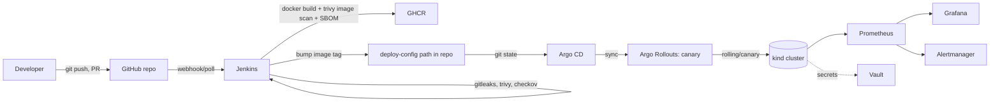

# Implementation Plan

Status: living document, updated at the end of every phase.

## 1. Environment inspection (2026-10-23)

| Item | Finding | Implication |
|---|---|---|
| Machine | MacBook Air, Apple M1, 8 cores | ARM64 — all images/binaries must be arm64 or multi-arch |
| RAM | **8 GB total** | Hard ceiling. This is the single biggest constraint on the whole architecture. |
| Disk | 29 GB free on host; Colima has a 100 GB sparse virtual disk | Enough, but image pulls (Jenkins, Prometheus, Grafana, Argo CD, kind node images are 1–2 GB each) add up — watch it. |
| Container runtime | Docker CLI 29.6.1 via **Colima** (not Docker Desktop), Colima VM currently 4 CPU / 5 GiB | Colima's VM allocation, not the host's 8 GB, is the real limit for anything containerized. |
| Already running | `kubesentinel-control-plane` — a kind cluster from an unrelated project (**Kube Sentinel**), up for 5 days, inside the same Colima VM | Shares the 5 GiB budget right now. I will not touch or stop it. You should `docker stop kubesentinel-control-plane` yourself before running our heaviest scenarios (monitoring stack + Argo CD + Jenkins together) if things feel tight. |
| kubectl / kind / minikube / helm / terraform / trivy / argocd CLI | All already installed | No install needed. |
| Java | **Not installed** | Needed only if running Jenkins natively. Decision: run Jenkins as a Docker container instead — avoids a host Java install entirely (see §3). |
| gitleaks / checkov / vault CLI | **Not installed** | Install via Homebrew when their phases start (all free, open-source, Apache-2.0/MPL). |
| Python | System 3.9.6, plus 3.12.15 via Homebrew | App will target 3.12 (brew) in a venv and in the Docker image; 3.9 is not used. |
| Git | 2.50.1, no global user.name/email | Set locally in this repo only (`Akanksha .` / `akankshav910@gmail.com`) — did not touch global git config. |
| Node | Not installed | Not needed anywhere in this stack. |

### Resource math that drives the design

Colima VM = 5 GiB. Rough steady-state memory per component once up:

| Component | Approx. RSS | Notes |
|---|---|---|
| kind control-plane (1 node) | ~900 MB–1.2 GB | Using a **single-node** kind cluster (control-plane doubles as worker) instead of multi-node, to halve this. |
| Jenkins (container, JVM) | ~600 MB–1 GB idle, more during a build | Only run while actively building; stop it otherwise. |
| Argo CD (api-server, repo-server, application-controller, redis, dex) | ~500–700 MB | Dex (SSO) will be disabled — not needed for a local demo, saves a pod. |
| Argo Rollouts controller | ~100 MB | Light. |
| kube-prometheus-stack (Prometheus, Grafana, Alertmanager, node-exporter, kube-state-metrics) | ~1.2–1.8 GB at default Helm values | Will be trimmed hard: 1 replica everywhere, short retention, no Thanos, dashboards limited to what we actually use. |
| Vault (dev mode) | ~100–150 MB | Cheapest major component. |
| The app itself (1–2 replicas) | ~100–150 MB | Trivial. |

**Conclusion:** running *everything* above simultaneously (~3.5–5 GB) inside a 5 GiB VM that also has the pre-existing `kubesentinel` cluster in it will not fit reliably, and the host only has 8 GB total to begin with, so growing the Colima VM much further starves macOS itself. The plan is therefore explicitly **phased, not always-on**:

- Jenkins is started only to run a pipeline, then stopped (`docker stop jenkins`). It does not need to coexist with the monitoring stack.
- The monitoring stack and Argo CD/Rollouts *do* need to coexist (CD + observability is one coherent demo), and that combination is the one sized against the 5 GiB budget.
- Every scenario's doc states exactly what must be running and gives a teardown command, per the user's own requirement in §8/§9 of the brief.
- If you want more headroom, raising Colima to 4 CPU / 6 GiB (`colima stop && colima start --cpu 4 --memory 6`) is a one-line, reversible change — I will ask before doing this myself rather than changing your shared dev VM unprompted, since it affects your other projects too.

## 2. Architecture

Sequence for "developer pushes code" (documented fully, with a real Mermaid sequence diagram, in `docs/ARCHITECTURE.md` once Phase 2 lands).

### Tool responsibilities (no tool added without a reason)

- **Jenkins** — CI only: lint, test, security scan, build, scan image, publish. Never touches the cluster.
- **Argo CD** — CD only: watches Git for the deploy-config, reconciles the cluster. Jenkins never runs `kubectl apply`/`helm upgrade` against the app — it only commits the new image reference to the deploy-config path, so there is exactly one path that mutates the cluster.
- **Argo Rollouts** — progressive delivery primitive (canary) used instead of a bare Deployment, so rollout health/abort/rollback can be demonstrated for real.
- **kind** — chosen over Minikube: faster startup, lower memory per node on this machine, and every node is just a container (fits the "everything is already in Colima" model) rather than a second VM.
- **Helm** — used for the app chart (dev/staging value overrides) and to install kube-prometheus-stack/Argo CD/Argo Rollouts (all ship official Helm charts). Kustomize is not added on top — one templating tool is enough and using both would be the "add a tool to pad the README" anti-pattern the brief explicitly forbids.
- **Terraform** — scoped to what's actually declarative local infra worth managing this way: the kind cluster config and any local-only resources. No cloud provider blocks exist by default; cloud is an explicitly optional, separately-documented extension requiring manual `terraform apply` approval.
- **Gitleaks / Trivy / Checkov** — secret scanning, dependency+image+filesystem scanning, and IaC scanning respectively. No overlap: each owns a distinct surface.
- **Vault (dev mode)** — demonstrates secret injection and the dev-mode-is-not-production caveat. Built last, documented as optional, because it's the component that's easiest to cut if RAM is tight and is lowest-value for interview purposes relative to its cost.

## 3. Phases

| Phase | Deliverable | Verification | Status |
|---|---|---|---|
| 1 | FastAPI app, tests, Dockerfile, local docker run | `pytest` green, container runs, `/health` `/ready` `/metrics` curl-verified | **Done** |
| 2 | Jenkinsfile (declarative, staged), run against local Jenkins container | Build #3 of `devsecops-platform-pipeline` ran green end-to-end: 18/18 tests, coverage gate (97.79% ≥ 80%), gitleaks (0 leaks), trivy fs + image scans (0 CRITICAL), checkov (1 soft-failed, documented), image built, CycloneDX SBOM generated. Evidence in `docs/evidence/phase2-build3-*`. Publish-to-GHCR stage exists but is parameter-gated off by default (see below). | **Done** |
| 3 | Kubernetes manifests + Helm chart, deployed to a fresh kind cluster manually | `kubectl get pods` healthy, smoke-tested via port-forward | Not started |
| 4 | Argo CD install + GitOps repo structure, reconciliation demo | Controlled manual drift corrected by Argo CD, observed | Not started |
| 5 | Argo Rollouts canary, deliberate bad release, abort/rollback | Rollout dashboard/CLI shows abort, old version still serving | Not started |
| 6 | kube-prometheus-stack, dashboards, alert rules, Alertmanager local receiver | Alert actually fires on induced load/failure | Not started |
| 7 | Security evidence wiring (scan artifacts retained, SBOM published) + Terraform for kind/local resources | Pipeline artifacts inspected | Not started |
| 8 | Vault dev-mode integration (optional) | Secret read via injected token, root token never committed/logged | Not started |
| 9 | All 9 acceptance scenarios executed and documented with actual output, final docs, demo script, resume bullets, interview guide | Each scenario run for real at least once | Not started |

Work proceeds one phase at a time; each phase ends with a report of what was actually run and verified (not just written), per the brief's instruction not to claim success without execution.

## 4. Free-cost strategy

- All tools are open-source/self-hosted (Jenkins, Argo CD, Argo Rollouts, Prometheus, Grafana, Alertmanager, Vault OSS, Trivy, Gitleaks, Checkov, kind, Terraform OSS).
- GHCR free tier used for image publishing (requires a GitHub PAT — manual step, see Phase 2 notes).
- No cloud resources created. Terraform's only default-enabled target is local (kind cluster config / local files). A cloud module may be added later, disabled by default, never applied without explicit approval.
- No paid vulnerability DBs — Trivy's free, offline-capable DB; limitations of DB freshness documented in `docs/SECURITY.md`.

## 4a. Phase 2 notes — Jenkins operational details, an incident, and what's deferred

**Running it:** `cd docker/jenkins && docker-compose up -d` (copy `.env.example` to `.env` first). UI at `http://localhost:8080`, login `admin` / the password in `.env`. The pipeline job `devsecops-platform-pipeline` polls GitHub every 5 minutes (`H/5 * * * *`) instead of using a webhook — Jenkins is on localhost, so GitHub cannot reach it; manual "Build Now" or the REST API (`/job/.../buildWithParameters`) are the other two trigger paths, documented fully in `docs/PIPELINE_WALKTHROUGH.md` once that's written (Phase 9).

**Incident during setup (fully resolved, no data lost):** the first `docker-compose up -d` for this project's Jenkins container used Compose's default (directory-derived) project name, which collided with an unrelated project's Jenkins compose setup (`AI Platform Assistant`) — both directories are named `jenkins` and both define a service named `jenkins`, so Compose matched and replaced that project's existing (already-stopped) container. Its named data volume was never touched, and the container was recreated from it with no loss, but it's the reason this project's `docker-compose.yml` now pins an explicit `name: devsecops-platform` at the top — every resource it creates is prefixed with that, so this can't happen again in either direction.

**Three real bugs found and fixed by actually running the pipeline** (not caught by review — only by execution, which is why this phase insisted on a real build, not just a lint of the Jenkinsfile):
1. `gitleaks detect --no-git` scans the working tree including gitignored files, so it flagged the local-only `docker/jenkins/.env` Jenkins password as a leak. Fixed by scanning git history instead (the correct behavior for a commit gate anyway) — gitignored files were never a commit risk.
2. `env.GIT_COMMIT` was read in the top-level `environment{}` block, which evaluates *before* the Checkout stage runs — it was always null. Fixed by computing `env.SHORT_SHA`/`env.IMAGE_TAG` inside Checkout's `script{}` block after `checkout scm`.
3. Plain top-level Groovy `def` variables (`JENKINS_CID`, then `PIP_CACHE_VOLUME`) do not reliably survive from one declarative stage into a later one under Jenkins' CPS runtime — both caused `MissingPropertyException` build failures. Fixed by resolving the container ID fresh via shell `$(hostname)` on every call, and inlining the cache-volume name as a literal, rather than caching either in a shared script variable.

**Deferred / not yet done:**
- **GHCR publish is real but untested end-to-end.** The `Publish image` stage exists, is parameter-gated (`PUBLISH_IMAGE`, default `false`), and gracefully falls back to "image stays local-only" if the `ghcr-credentials` Jenkins credential is absent — which it currently is. The existing `gh` CLI token (scopes: `gist`, `read:org`, `repo`, `workflow`) lacks `write:packages`, so it cannot push to GHCR as-is. To actually exercise this stage: create a classic GitHub PAT with `write:packages`+`read:packages`, add it to Jenkins (Manage Jenkins → Credentials → add a "Username with password" credential with ID `ghcr-credentials`, username = GitHub username, password = the PAT), then re-run with `PUBLISH_IMAGE=true`. Not done yet because it needs a credential only the user can create (never asked to paste secrets into chat) — tracked as a Phase 2 follow-up, not blocking Phase 3.
- Multibranch/PR-safe publish gating (`github-branch-source` plugin) was deliberately skipped in favor of a single-branch job pointed at `main` — there are no PR builds yet, so "never publish from an untrusted PR" is satisfied by construction rather than by a branch condition. Revisit if/when PR builds are added.

## 5. Open questions / manual steps the user must do

- Create the GitHub repository and push (I won't create it or push without being asked).
- Generate a GitHub PAT (or use `GITHUB_TOKEN` in a self-hosted Jenkins credential) for GHCR push — I will never ask you to paste a secret into chat; it goes into Jenkins' own credential store or a local `.env` excluded via `.gitignore`.
- Decide, before Phase 6, whether to temporarily raise Colima's memory allocation.
